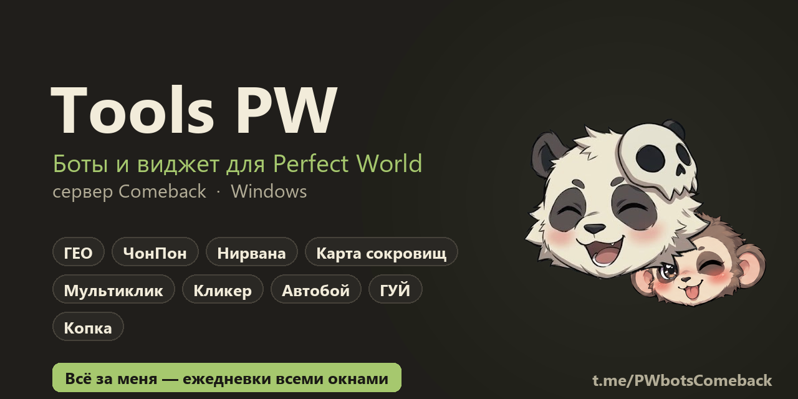
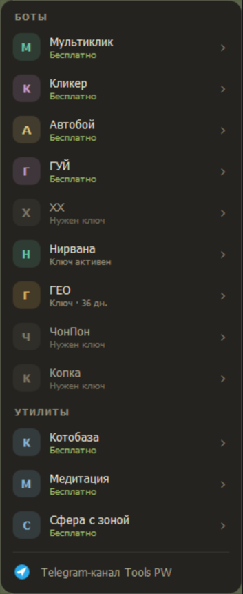
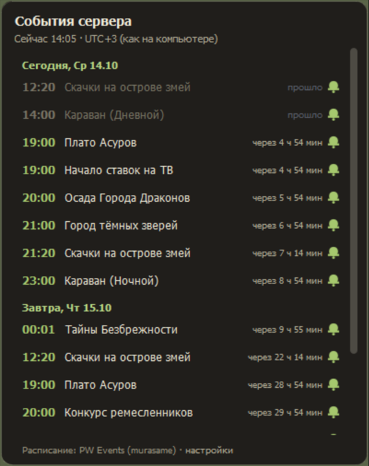
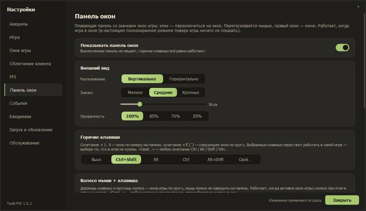
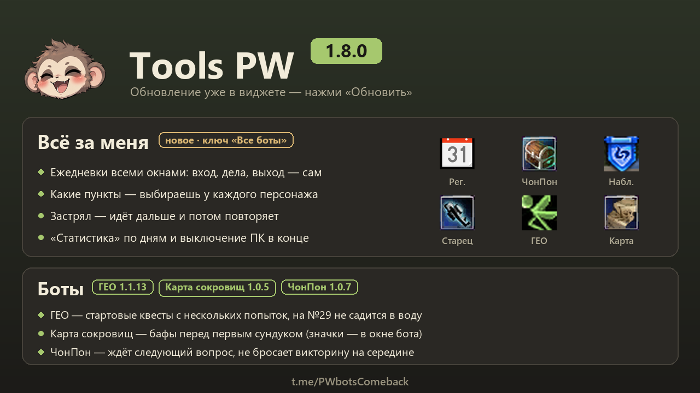

# Tools PW — боты для Perfect World (Comeback)

**Виджет-лаунчер и набор ботов для Perfect World (ПВ) на сервере Comeback:**
ГЕО, ЧонПон, Нирвана, Карта сокровищ, мультиклик, кликер, автобой и ежедневки всеми окнами.

### [⬇ Скачать Tools PW для Windows](https://github.com/AltF4-YT/altf4-launcher-releases/releases/download/installer/ToolsPW_Install.exe)

[Telegram-канал](https://t.me/PWbotsComeback) · [Магазин ключей](https://t.me/ToolsPWSHOP_bot) · [Все версии](https://github.com/AltF4-YT/altf4-launcher-releases/releases)

---

## Что это

**Tools PW** — маленький виджет-кружок (панда Моти или обезьянка Укун) поверх рабочего стола.
Из него запускаются окна игры по группам персонажей и все боты. Обновления приходят сами:
виджет предлагает обновиться, когда выходит новая версия.

- 🎮 **Запуск окон группой** — логины и пароли хранятся зашифрованными (Windows DPAPI), есть автовход и двухфакторка (2FA).
- 🪟 **Панель окон** — значки окон игры поверх всего: переключение кликом, горячими клавишами или колёсиком мыши.
- 📅 **События сервера** — расписание с напоминаниями по вашему часовому поясу.
- ✅ **Ежедневки** — таблица «дела × персонажи», отметки сбрасываются по времени сервера.
- 🤖 **Всё за меня** — виджет сам по очереди заводит окна, делает ежедневки и закрывает окна.
- ⚡ **Облегчение клиента и FPS** — меньше нагрузки на ПК, когда открыто много окон.
- 🗺 **Утилиты** — карта ресурсов, «Куб судьбы», «Лут ХХ», задания дня.

## Боты

### Бесплатные

| Бот | Что делает |
|---|---|
| **Мультиклик** | Повторяет ваш клик во всех окнах игры сразу |
| **Кликер** | Клики по списку точек в фоновом окне, по кругу |
| **Автобой** | Бой в фоне: цель, умения, свой профиль на каждое окно |
| **ГУЙ** | Клики по таймеру волн и боссов в Гуй Му, до 6 окон |
| **Котобаза** | Цены с comeback.pw/cats по горячей клавише прямо поверх игры |
| **Медитация** | Считает, сколько медитировать до нужного уровня |
| **Сфера с зоной** | Ставит в клиент файлы, с которыми видна зона сферы |

### По ключу

| Бот | Что делает |
|---|---|
| **ГЕО** | Ежедневка ГЕО: руна, полёт, сдача, награда — сам, несколькими окнами |
| **Карта сокровищ** | Ежедневная «Карта сокровищ»: от НИПа до сундука и награды |
| **ЧонПон** | Викторина у Мудрецов Чона и Пона — ответы встроены, шаблоны настраивать не нужно |
| **Нирвана** | Бой в Нирване и авто-проход данжа магом и стражем |
| **Копка** | Сбор по точкам с ремонтом и повтором кругов |

**Цены:** любой бот — 300 ₽ / 30 дней, все боты сразу — 1000 ₽ / 30 дней.
Ключ «Все боты» открывает и режим **«Всё за меня»**. Купить или продлить — в боте
[@ToolsPWSHOP_bot](https://t.me/ToolsPWSHOP_bot), оплата картой, ключ приходит сразу.

## Установка

1. Скачайте [ToolsPW_Install.exe](https://github.com/AltF4-YT/altf4-launcher-releases/releases/download/installer/ToolsPW_Install.exe) и запустите — он сам скачает свежую версию виджета и ботов.
2. При первом запуске мастер попросит папку игры и аккаунты.
3. Дальше виджет обновляется сам — архивы в [релизах](https://github.com/AltF4-YT/altf4-launcher-releases/releases) нужны только ему.

## Что нового

Список изменений каждой версии — на странице [релизов](https://github.com/AltF4-YT/altf4-launcher-releases/releases) и в [Telegram-канале](https://t.me/PWbotsComeback).

## Вопросы

**Это безопасно для аккаунта?** Боты кликают в окна игры сообщениями Windows и смотрят на картинку окна —
в память клиента не лезут. Пароли не уходят никуда, кроме окна игры.

**Где спросить?** В [Telegram-канале](https://t.me/PWbotsComeback).

---

Tools PW · Perfect World · ПВ · Comeback PW · боты для ПВ · автоматизация ежедневок

